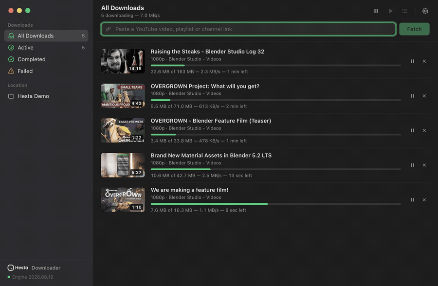
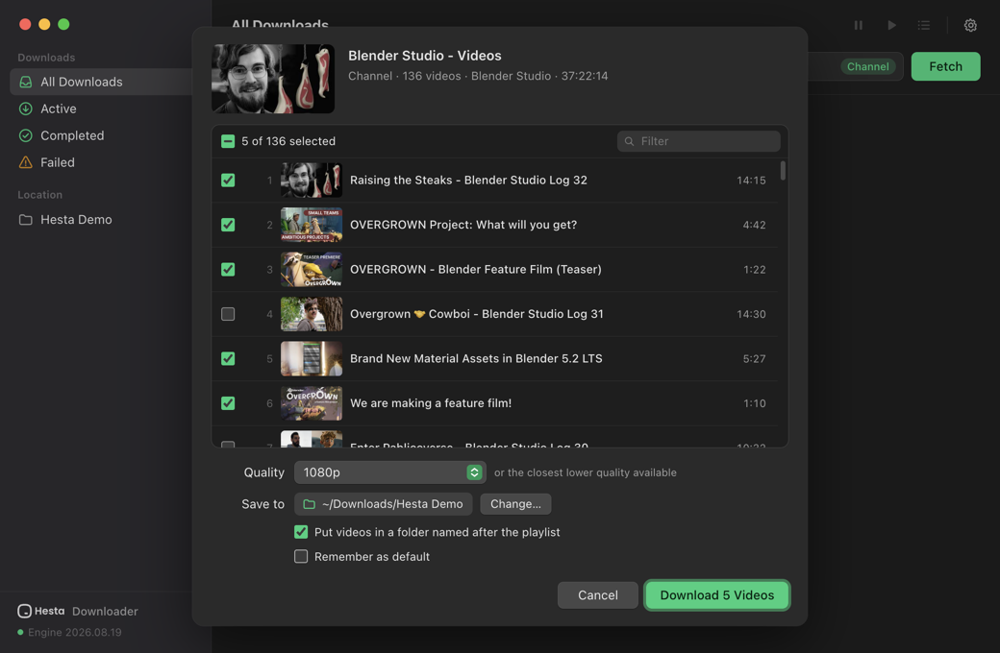
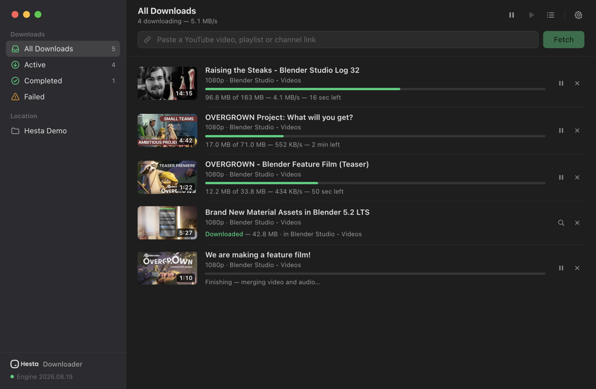
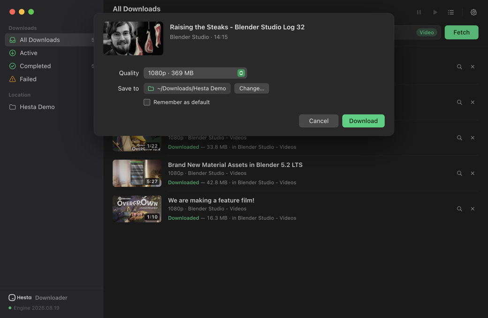
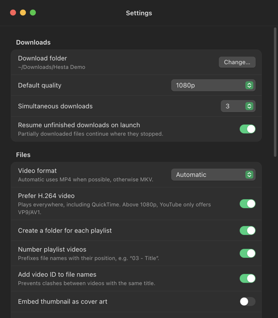

# Hesta Downloader

A simple Mac app for downloading YouTube videos, Shorts, playlists and whole channels — by
[Hesta](https://hesta.io).

Paste a link, pick the videos and the quality you want, and hit Download.



## Download

| Mac | Download |
| --- | --- |
| **Apple Silicon** (M1, M2, M3, M4…) | [Hesta-Downloader-1.0.0-arm64.dmg](https://github.com/hesta-io/youtube-downloader/releases/download/v1.0.0/Hesta-Downloader-1.0.0-arm64.dmg) |
| **Intel** | [Hesta-Downloader-1.0.0-x64.dmg](https://github.com/hesta-io/youtube-downloader/releases/download/v1.0.0/Hesta-Downloader-1.0.0-x64.dmg) |

Not sure which one? Open *Apple menu → About This Mac*. If it says "Chip: Apple M…", pick
Apple Silicon; if it says "Processor: Intel…", pick Intel.
Other versions are on the [releases page](https://github.com/hesta-io/youtube-downloader/releases).

**Installing:** open the downloaded file and drag **Hesta Downloader** into **Applications**.

**First launch:** macOS may say the app can't be checked for malicious software. Go to
*System Settings → Privacy & Security*, scroll down and click **Open Anyway**. You only need to
do this once.

## What it does

- **Works with any YouTube link** — videos, Shorts, live streams, playlists, mixes, music albums
  and channels. You can even paste a block of text with several links in it.
- **Pick what you want from a playlist** — see every video with its thumbnail and length, then
  select all of them or just a few.
- **Choose the quality** — from 4K/8K down to 144p, or audio only (M4A or MP3).
- **Pause and resume** — stop a download and pick it up later, even after quitting the app.
- **Several downloads at once**, with automatic retries if your connection drops.
- **Feels at home on a Mac** — light and dark mode, Dock progress, notifications, drag and drop,
  and it notices when you copy a YouTube link.
- **Nothing else to install** — everything it needs is included and kept up to date.

## Screenshots

**Choose videos from a playlist or channel**



**Watch your downloads**



**Pick the quality for a single video**



**Settings**



## Tips

- **"YouTube is asking to confirm you're not a bot"** — sign in to YouTube in your web browser,
  then in Hesta Downloader open *Settings → Use cookies from* and choose that browser. If your Mac
  asks for permission, click *Always Allow*.
- **A download keeps failing** — choose *Hesta Downloader → Check for Engine Updates…* from the
  menu bar, then try again.
- **Shortcuts** — ⇧⌘V pastes a link and fetches it straight away; ⌘, opens Settings.

## For developers

You need macOS and [Node.js](https://nodejs.org) 20 or newer.

```sh
npm install     # set up
npm start       # run the app
npm run dist    # build the .dmg files into dist/
```

Built with Electron, [yt-dlp](https://github.com/yt-dlp/yt-dlp) and [FFmpeg](https://ffmpeg.org).
